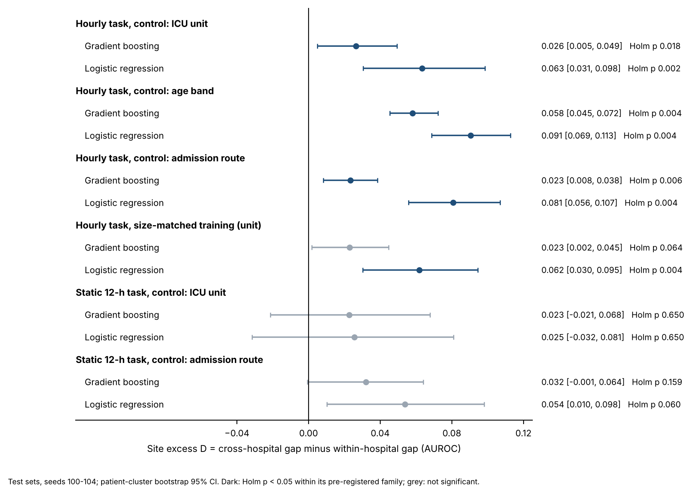

# Cross-hospital versus within-hospital transfer of sepsis early-warning models: a staged, pre-specified factorial analysis of two hospital systems

**Authors:** [to be completed by the authors]
**Corresponding author:** [to be completed]

## Abstract

**Background.** Sepsis early-warning models lose accuracy in new hospitals, but external validations cannot separate loss caused by the new *hospital* (measurement practice, encoding, labelling) from loss caused by different *patients*. Overlap-based decomposition methods fail because hospitals are almost perfectly separable from their data.

**Methods.** Using the open PhysioNet/CinC 2019 data (two US hospital systems), we crossed hospital with ICU unit (MICU/SICU). Models trained in one cell were evaluated in the same unit of the other hospital (site transfer) and in the other unit of the same hospital (population transfer; identical encoding). The site excess D is the site-transfer AUROC loss minus the population-transfer loss. Analysis plans and code were frozen before each test-set analysis; inference used a patient-cluster bootstrap over five seeds with Holm correction.

**Results.** For hourly prediction, D was 0.026 AUROC (95% CI 0.005–0.049; Holm p = 0.018) for gradient boosting and 0.063 (0.031–0.098; Holm p = 0.002) for logistic regression, and remained positive with age band or admission route as the within-hospital contrast (all Holm p ≤ 0.006). Restricted to pre-onset hours (post hoc), D remained for logistic regression (0.059, 0.027–0.094) but not for gradient boosting (0.019, −0.006 to 0.041). With a target-tuned 90%-specificity threshold (post hoc), site transfer lowered sensitivity by 12.7 percentage points versus 6.5 for population transfer. Label-free fixes did not improve transported AUROC (0.763 vs 0.762); their pre-specified (revised) criterion was met only because within-hospital performance fell. Three label-free AUROC estimators erred by more than 0.03 in 77–100% of transfers. The excess was not confirmed for a static 12-h task, was absent for gradient boosting in an exploratory hypotension task, and one within-hospital split by total length of stay produced a larger gap than changing hospital.

**Conclusions.** Between these two hospital systems, hourly sepsis models lost more when moving hospital than when moving to a different admission-defined patient group within a hospital; for gradient boosting this largely reflected recognition of established sepsis. The loss was not repaired by unlabelled harmonisation and not captured by the label-free estimators tested. Because the effect depends on task and model, local labelled verification remains necessary.

**Keywords:** sepsis; early warning; machine learning; external validation; transportability; dataset shift; intensive care unit

## Background

Machine-learning early-warning models for sepsis are increasingly deployed, and their main documented weakness is transport. A widely implemented proprietary sepsis model performed substantially worse at external validation than reported by its developer [1]. Deep-learning sepsis models lose accuracy across international sites [2] and under multi-centre distribution shift [3]. The PhysioNet/Computing in Cardiology Challenge 2019 concluded that generalisation to different hospital systems remained a challenge [4]. Generalisability itself has been argued to be partly a myth when practices differ between hospitals [5]. In recent *Critical Care* studies, internal-to-external drops of up to 13.8% in AUROC are reported when a model is trained on a single distinctive source [6].

These results say that models lose accuracy, not why. For an adopting hospital, two reasons have different remedies. A *population* difference — a surgical rather than a medical ICU, older patients, a different admission route — might be addressed by choosing a model trained on similar patients. A *site* difference — measurement frequency, assay and unit conventions, charting resolution, practice behind the sepsis label — travels with the hospital whatever the patients. Classical external-validation frameworks separate case mix from incorrect coefficients with benchmark values or membership models [7, 8], propensity-based standardisation adjusts discrimination for case mix [9], and machine-learning attribution methods split a performance gap into covariate and conditional components [10–12]. These approaches lose reliability when the populations barely overlap. Between the two PhysioNet 2019 hospitals, a classifier separates the sites almost perfectly from data alone, including from vital signs only; importance weights then collapse.

Related work has approached the site question from other angles. Adversarial domain separation was used to learn representations that separate population shift from data-collection bias across EHR systems for septic shock prediction [13]. A representation-learning method for prediction in new environments used hospital × recorded-unit partitions of these same PhysioNet 2019 data as environments [14]; the partitioning is therefore not new, and our contribution is the gap contrast between them. In medical imaging, a crossed centre × annotator design has been used to attribute performance gaps to acquisition versus annotation shift [23]. Vital-sign record density was shown to vary mostly between hospitals rather than between units [15]. Within-hospital and between-hospital shifts have been compared as separate settings for conformal coverage [16]. Multi-institution training has been shown to affect ICU model generalisability, with unit mix as a confounder [17]. Observation-process features have been associated with larger cross-database drops [18]. Hospital-level heterogeneity of mortality models has been described across many eICU hospitals [19]. None of these compares the cost of cross-hospital transfer with the cost of within-hospital transfer between patient groups as an overlap-free yardstick.

We therefore used a design that needs no overlap: transferring a model between ICU units *within* a hospital, where data encoding is identical, gives an empirical yardstick for a population shift. Crossing hospital with unit lets the site excess be estimated directly. We asked whether moving hospital costs more than moving population within a hospital, whether label-free remedies remove the difference, whether transported performance can be estimated without labels, and how robust the answer is across contrasts, metrics and tasks.

## Methods

### Data and cohort
We used the training set of the PhysioNet/Computing in Cardiology Challenge 2019 (CC BY 4.0) [4]: hourly records of 40,336 ICU stays from two US hospital systems (A: 20,336 stays; B: 20,000) with 40 vital-sign, laboratory and demographic variables and the Challenge sepsis label (Sepsis-3 based; positive from 6 h before onset onwards) [4]. All files were validated (41 columns, contiguous hourly records). Stays with a recorded unit (MICU or SICU) formed four cells: A-MICU, A-SICU, B-MICU, B-SICU (24,719 stays; 940,250 patient-hours; 1,616 stays with sepsis). Stays without a recorded unit were excluded from the unit analyses but included in the age-band and admission-route analyses, which used all stays. Patient characteristics by cell, including the excluded stays, are in Additional file 4; cells differed in sepsis prevalence (4.1–10.8%), admission route and laboratory measurement frequency (for example, lactate ever measured in 12.5–47.6% of stays).

### Splits and leakage control
Within each hospital, stays were split 60/20/20 into training, validation and test sets, stratified by sepsis status, with a seed fixed before modelling; the split file is versioned with the code. Test cells contained 1,056–1,400 stays (48–115 with sepsis). An automated check confirmed that no stay appeared in more than one split or cell, no patient time series was duplicated, features used no future information (features rebuilt from records truncated at a random hour matched full-record features in 200 of 200 sampled stays), no label or identifier was a feature, and fitting and model selection used only source-cell training and validation rows. Admission route and ICU length of stay so far are derived from the same timestamps, but the route factor is fixed at ICU admission and does not use outcome information.

### Features and models
Each patient-hour had 134 features computed from data available up to that hour: last observed value of each variable, 6-h rolling mean/min/max and 6-h change for vital signs, measurement-process features (hours since last measurement and number of measurements in the past 24 h per variable), and age, sex, ICU length of stay so far and time from hospital to ICU admission. Gradient-boosted trees (LightGBM; missing values handled natively; number of leaves chosen from {15, 63, 255}, learning rate 0.05, early stopping on source-validation AUROC) and L2-regularised logistic regression (median imputation, missingness indicators, standardisation; C chosen from {0.01, 0.1, 1}) had the same tuning budget of three configurations.

### Factorial transport design
For target cell t, the *local* model was trained in t, the *population-transfer* source in the other unit of the same hospital, the *site-transfer* source in the same unit of the other hospital, and the *both* source in the other unit of the other hospital. With gap = AUROC(local) − AUROC(transferred), all evaluated on t's test stays, the site excess is

D(t) = gap_site(t) − gap_population(t) = AUROC_t(population source) − AUROC_t(site source),

so the local model cancels. The primary statistic is D averaged over the four target cells and five confirmation seeds (hour-level AUROC). Because the site source also differs in patient mix from the target (the hospitals' MICUs are not identical populations), D is not identified as a pure site effect; it is the excess cost of cross-hospital over within-hospital transfer, and an upper bound on the site component relative to an admission-defined population shift.

### Additional analyses
- *Label-free remedies:* harmonisation of encoding artefacts (calcium values below 2 in hospital B set missing as a probable different assay, age rounded, EtCO2 removed), removal of measurement-process features, and per-hospital quantile normalisation fitted on unlabelled training rows.
- *Label-free performance estimation:* internal AUROC, model-implied AUROC and importance-weighted AUROC compared with the observed transported AUROC; and a split-half check of how many labelled local stays give an AUROC estimate within ±0.03.
- *Other within-hospital contrasts:* age band (< 65 vs ≥ 65 years) and admission route (ICU admission within 24 h of hospital admission vs later) replaced ICU unit.
- *Feature groups:* models restricted to vital signs, laboratory values, all-but-process or process-only features.
- *Size-matched training:* each source cell subsampled to the smallest cell's size.
- *Pooled training:* for each target, the other unit of the same hospital plus the same unit of the other hospital.
- *Second task:* a static task reproducing a published protocol [20]: one prediction per stay at hour 12 from 12-h window summaries, for sepsis after hour 12.
- *Dose–response control (exploratory, validation only):* 11 within-hospital partitions (unit, three age cut-offs, sex, two admission-route definitions, total stay ≥ 48 h, three random halves) with label-free shift size from a domain classifier.
- *Exploratory third-database analysis (validation only):* hypotension early warning across the two PhysioNet 2019 hospitals and the PhysioNet 2012 database, with the same unit design.
- *Secondary and post-hoc outcomes:* AUPRC, calibration slope and calibration-in-the-large (pre-specified secondary); patient-level AUROC; and, added post hoc, pre-onset AUROC (each septic stay contributes only its first six positive hours, so recognition of established sepsis is excluded) and patient-level sensitivity at 90% specificity. For the latter, a stay counts as detected if its maximum hourly risk at any time exceeds a threshold set on each target cell's own labels for every model — an optimistic, recalibrated deployment that does not measure lead time.

### Staged pre-specification and statistics
The study ran in stages (Additional file 2 lists each plan, its freeze date and what had been seen when it was written). In each stage, exploration used the validation sets and seeds 0–2; the plan and analysis script were then frozen in version control before the test sets were used once, with seeds 100–104 fixed at project start. Plans written after the first test analysis (age band, admission route, feature groups, size matching, second task, dose–response) were informed by earlier test results; they are pre-specified relative to their own test analyses only. For the label-free remedies, the pre-specified directional hypothesis (share removed < 0.5) was changed to an estimation target after validation results and before the test analysis. Inference used a patient-cluster bootstrap within each target cell (2,000 resamples for hour-level statistics, 400 for patient-level; the same resampled stays for all models), averaging AUROC over seeds within each replicate; two-sided p = 2·min(P(D* ≤ 0), P(D* ≥ 0)), with a floor of one resample (reported values of 0.0005 should be read as p ≤ 0.001). The bootstrap conditions on the fixed split and training data; seed-to-seed SDs are reported, and logistic regression is deterministic, so its five seeds amount to a single fit. Post-hoc analyses used 1,000 resamples. Holm correction was applied within each pre-specified family. Every variant evaluated during the project (more than 300 validation evaluations) was logged, and every pre-specified test is reported.

### Comparison with published results
We re-implemented the closest published cross-hospital protocol on the same data [20] from its abstract (the full text was not accessible to us), so this comparison is approximate.

## Results

### Reproduction of published numbers
Under the published protocol our cohort comprised 30,629 stays with 1,837 sepsis events (published: 30,646 and 1,843) [20]. Gradient boosting reached AUROC 0.773 in A and 0.658 after A→B transfer, and 0.723 in B and 0.646 after B→A transfer (validation halves, single seed), against published XGBoost values of 0.725→0.608 and 0.702→0.636. The A→B drop was nearly identical (−0.115 vs −0.117).

### Overlap between hospitals
In the diagnostic phase (validation only), a domain classifier separated the hospitals with AUC 0.9996 after repairing encoding artefacts, and 0.978 with vital signs only; importance weighting had an effective sample size of 2–5%.

### Site excess (primary analysis)
Moving a model to the other hospital cost 0.071 AUROC for gradient boosting, against 0.045 for moving to the other unit of the same hospital: D = 0.026 (95% CI 0.005–0.049; Holm p = 0.018). For logistic regression D = 0.063 (0.031–0.098; Holm p = 0.002) (Table 1). D was positive in all four target cells for both models, and patient-level AUROC agreed. On average, moving both hospital and unit cost most (AUROC 0.735 for gradient boosting; Table 2), although for logistic regression the both-source outperformed the site source in two target cells. Effects were smaller than in validation (gradient boosting 0.043).

**Table 1.** Transport gaps on the test sets (hour-level AUROC, mean of four target cells, five seeds; 95% bootstrap CI).

| Model / level | Gap, other unit same hospital | Gap, same unit other hospital | Site excess D | Holm p |
|---|---|---|---|---|
| Gradient boosting, hour | 0.045 (0.027–0.061) | 0.071 (0.053–0.090) | 0.026 (0.005–0.049) | 0.018 |
| Gradient boosting, patient | 0.048 (0.025–0.072) | 0.087 (0.062–0.110) | 0.039 (0.010–0.067) | — |
| Logistic regression, hour | 0.052 (0.027–0.077) | 0.116 (0.087–0.146) | 0.063 (0.031–0.098) | 0.0015 |
| Logistic regression, patient | 0.053 (0.025–0.079) | 0.101 (0.069–0.132) | 0.048 (0.014–0.081) | — |

### Clinical translation, calibration and early-warning hours
At a threshold giving 90% patient-level specificity in the target (post hoc), the local gradient-boosting model detected 57.2% of septic stays; a model from the other unit detected 50.7% and a model from the other hospital 44.5%. The sensitivity loss was 0.127 (0.079–0.169) for site transfer versus 0.065 (0.021–0.106) for population transfer, a difference of 0.062 (0.021–0.103); for logistic regression 0.060 (−0.003 to 0.120) (Table 2). Calibration slope (pre-specified secondary) was lower after site transfer than after population transfer (0.713 vs 0.816 for gradient boosting; 0.408 vs 0.603 for logistic regression), but calibration-in-the-large was not consistently worse (gradient boosting −0.244 vs −0.283); no confidence intervals were computed for these contrasts. When post-onset hours were removed (post hoc), the site excess remained for logistic regression (0.059, 0.027–0.094) but was smaller and no longer distinguishable from zero for gradient boosting (0.019, −0.006 to 0.041).

**Table 2.** Secondary and post-hoc outcomes by transfer type (test sets; mean of four target cells, five seeds).

| Model | Source | AUROC | AUPRC | Calibration slope | Sensitivity at 90% specificity (post hoc) |
|---|---|---|---|---|---|
| Gradient boosting | Local | 0.834 | 0.099 | 0.840 | 0.572 |
| Gradient boosting | Other unit, same hospital | 0.789 | 0.082 | 0.816 | 0.507 |
| Gradient boosting | Same unit, other hospital | 0.763 | 0.064 | 0.713 | 0.445 |
| Gradient boosting | Other unit, other hospital | 0.735 | 0.063 | 0.726 | — |
| Logistic regression | Local | 0.789 | 0.085 | 0.691 | 0.503 |
| Logistic regression | Other unit, same hospital | 0.737 | 0.071 | 0.603 | 0.468 |
| Logistic regression | Same unit, other hospital | 0.674 | 0.054 | 0.408 | 0.407 |
| Logistic regression | Other unit, other hospital | 0.667 | 0.060 | 0.345 | — |

### Other within-hospital contrasts
With age band or admission route as the within-hospital contrast, the cross-hospital loss again exceeded the within-hospital loss for both models (Table 3; Holm p ≤ 0.006). The age-band shift barely affected performance (within-hospital gap 0.004), so that comparison is weak; admission route (0.026) and ICU unit (0.045) are the informative contrasts.

**Table 3.** Site excess with other within-hospital contrasts (test sets).

| Contrast | Model | Within-hospital gap | Cross-hospital gap | D (95% CI) | Holm p |
|---|---|---|---|---|---|
| Age band | Gradient boosting | 0.004 | 0.062 | 0.058 (0.045–0.072) | 0.0035 |
| Age band | Logistic regression | 0.003 | 0.094 | 0.091 (0.069–0.113) | 0.0035 |
| Admission route | Gradient boosting | 0.026 | 0.050 | 0.023 (0.008–0.038) | 0.006 |
| Admission route | Logistic regression | 0.035 | 0.115 | 0.081 (0.056–0.107) | 0.0035 |

**Figure 1.** Site excess D (cross-hospital gap minus within-hospital gap, AUROC) for every pre-specified site-excess test on the test sets (seeds 100–104; 95% patient-cluster bootstrap CI). Dark markers: Holm p < 0.05 within the pre-specified family; grey: not significant. Generated by scripts/figure_forest.py from the result files.

### Label-free remedies
The pre-specified estimate of the share of D removed by all three label-free fixes was 0.85 (95% CI 0.26–3.13; test of a reduction, Holm p = 0.010), meeting its pre-specified criterion; the wide ratio interval indicates instability. A decomposition we added after seeing this result shows how D shrank: the mean AUROC of site-transferred models did not change (0.763 without fixes, 0.762 with them), whereas within-hospital transfer fell (0.790 to 0.766) and local models fell (0.834 to 0.813). The fixes narrowed D by degrading performance inside the source hospital rather than by improving transport. Harmonisation alone removed nothing (share −0.07, −0.62 to 0.26).

### Label-free performance estimation
The three label-free estimates missed the transported AUROC by more than 0.03 in 77–80% of transfer × seed combinations for gradient boosting and 92–100% for logistic regression (n = 60 each; Table 4). Importance weighting was nearly unbiased for gradient boosting (mean error +0.003) but had a mean absolute error of 0.067. In a split-half check, 400 labelled local stays gave an AUROC estimate within ±0.03 only 41% (gradient boosting) and 37% (logistic regression) of the time.

**Table 4.** Label-free estimation of transported AUROC (test sets).

| Model | Estimator | Mean absolute error | Mean error | Share with error > 0.03 |
|---|---|---|---|---|
| Gradient boosting | Internal AUROC | 0.072 | +0.072 | 0.80 |
| Gradient boosting | Model-implied | 0.064 | +0.045 | 0.77 |
| Gradient boosting | Importance-weighted | 0.067 | +0.003 | 0.77 |
| Logistic regression | Internal AUROC | 0.097 | +0.097 | 0.92 |
| Logistic regression | Model-implied | 0.164 | +0.164 | 1.00 |
| Logistic regression | Importance-weighted | 0.138 | −0.086 | 0.92 |

### Feature groups, size and pooling
The pre-specified contrast between all-feature and vital-sign-only models (0.018, −0.001 to 0.036; Holm p = 0.064) was not significant. In estimation-only analyses, models restricted to measurement-process features had the largest site excess (0.046, 0.022–0.070), and vital-sign-only, laboratory-only and all-but-process models had 0.008–0.009 with intervals including zero. With size-matched training, D remained for logistic regression (0.062, 0.030–0.095; Holm p = 0.0035); for gradient boosting the point estimate was similar (0.023, 0.002–0.045) but did not survive correction (Holm p = 0.064). Adding the other hospital's same-unit data to the same hospital's other-unit data improved AUROC by 0.012 (−0.000 to 0.026).

### Second task, dose–response and third database
For the static 12-h task, all four site-excess estimates were positive (0.023–0.054) but none survived correction (Holm p 0.06–0.65); test cells contained only about 25–60 events. In the exploratory dose–response analysis (validation), the transport gap was weakly related to shift size, the hospitals lay far outside the range of within-hospital shift sizes, and the cross-hospital gap was not above the extrapolated within-hospital trend (primary, symmetric-KL shift size: residual −0.076, −1.511 to 0.033; domain-AUC shift size: 0.017, −0.064 to 0.060). One partition — total ICU stay of at least 48 h versus shorter, not known at admission — produced a larger within-hospital gap (0.196) than moving hospital (0.069); among partitions known at admission, the cross-hospital gap was larger than every within-hospital gap (a post-hoc observation). In the exploratory three-database hypotension analysis, transport losses were small and gradient boosting showed no site excess (−0.0013, −0.0041 to 0.0013), whereas logistic regression showed a small one (0.0177, 0.0128 to 0.0221) (Additional file 1).

## Discussion

Between two US hospital systems, hourly sepsis early-warning models lost more accuracy when moved to the other hospital than when moved to a different admission-defined patient group within their own hospital. The excess was present in discrimination, in sensitivity at a fixed specificity, and in calibration, and was not repaired by unlabelled harmonisation or detectable with label-free estimators. It was, however, model- and task-dependent: it weakened for gradient boosting when only pre-onset hours were scored, was not confirmed in a static task, and was absent for gradient boosting in an exploratory hypotension task.

**What this adds.** Prior work has separated case mix from coefficient failure with methods that need overlapping populations [7–12], learned site-invariant representations [13, 14], and described hospital-level variation in measurement density [15] and model performance [19]. Our contribution is an overlap-free yardstick — transfer between patient groups of the same hospital — against which the cost of cross-hospital transfer can be compared on real multi-site ICU data, together with evidence that the excess is not removed by unlabelled corrections. The same contrast can be reported alongside external validation whenever a dataset contains several units in several hospitals.

**Clinical interpretation.** At a target-tuned threshold giving 90% specificity, a model imported from the other hospital flagged 12.7 percentage points fewer septic stays than the local model (about a fifth of the stays the local model flagged), roughly twice the loss from importing a model from the other unit of the same hospital; because the threshold was tuned on target labels and detection included post-onset hours, real deployment would likely fare worse. In our data, a model from the same hospital but a different unit was the better starting point, and adding external same-unit data helped little. Calibration slopes of imported models were lower, which matters if alert thresholds are set on predicted risk.

**Why remedies and estimators failed.** The site excess concentrated in models that rely on measurement-process features — information that is predictive locally because it reflects local practice. Removing these features narrowed the excess only by lowering within-hospital accuracy, consistent with cross-database observations for observation-process features [18]. Label-free estimators assume a stable relation between features and outcome, which is the very assumption the site component violates; label-free AUROC estimation has likewise been found unreliable under prevalence shift in chest radiographs [21]. We tested only three simple estimators; methods such as average thresholded confidence [22] were not evaluated.

**Implications.** (1) When multi-unit, multi-site data are available, report the within-hospital transfer as a yardstick next to external validation. (2) Do not expect unlabelled harmonisation or the simple label-free estimators tested here to substitute for local verification. (3) Plan labelled local verification: even 400 labelled stays did not reliably determine the transported AUROC to ±0.03.

**Limitations.** First, there are only two hospital systems; findings concern this pair, and stays, not hospitals, are the unit of inference. No other open dataset offers several hospitals with unit information at sufficient size (the open eICU demonstration subset has at most 40 stays per hospital). Second, D is an upper bound on the site component: same-unit populations differ between hospitals, and the within-hospital contrasts are weaker covariate shifts than the site shift (domain-classifier AUC 0.71–0.97 within vs 1.00 between); the exploratory dose–response analysis could not resolve this, and one partition defined by total stay length produced a larger within-hospital loss — a partition mechanically linked to the ICU-length-of-stay feature and not known at admission. Third, the effect is model- and task-dependent (pre-onset scoring, static task, hypotension), and several pre-specified tests failed (feature-group contrast, size-matched gradient boosting, all static-task tests). Fourth, later analysis plans were written after earlier test results were known (Additional file 2), and the label-free-remedy hypothesis was changed from directional to estimation after validation. Fifth, uncertainty intervals condition on one split and training set; validation effects were consistently larger than test effects. Sixth, the hospital-B split had to be reconstructed after a data re-download changed the deterministic split; validation and test sets were verified identical to the originals, but one training cell differed by a few stays during exploration, and gradient-boosting results varied by up to 0.018 AUROC in single validation cells between computing environments. Seventh, 39% of stays lacked a recorded unit and were excluded from the unit analyses (they were included in the age and admission-route analyses). Eighth, the sepsis label is itself generated from site-specific documentation, so part of the site component may be a labelling difference. Ninth, the third database in the exploratory hypotension analysis (PhysioNet 2012, MIMIC-II) may originate from the same hospital as system A, which we could not verify, and within-site losses in that task were too small to discriminate between hypotheses. Tenth, the primary hour-level AUROC includes post-onset hours, so it measures recognition of established sepsis as well as early warning. Finally, the published comparison relied on a preprint's abstract.

## Conclusions

Between two hospital systems, hourly sepsis early-warning models lost more accuracy when moving hospital than when moving to a different admission-defined patient group within a hospital, and this loss was not repaired by unlabelled harmonisation or detectable without local labels. Because the effect varied with model and task, hospitals adopting such models should plan for local labelled verification rather than rely on population similarity.

## Abbreviations
AUPRC, area under the precision–recall curve; AUROC, area under the receiver operating characteristic curve; CI, confidence interval; ICU, intensive care unit; MICU, medical ICU; SICU, surgical ICU.

## Additional files
- Additional file 1: secondary, exploratory and failed analyses (tables generated by the analysis scripts).
- Additional file 2: staged pre-specification timeline (plan versions, freeze commits, what was known at each stage).
- Additional file 3: TRIPOD+AI checklist.
- Additional file 4: patient characteristics by hospital × unit cell, including stays without a recorded unit.

## Declarations
- **Ethics approval and consent to participate:** Secondary analysis of a public, de-identified dataset (PhysioNet/CinC 2019, CC BY 4.0). [Authors to confirm institutional requirements.]
- **Consent for publication:** Not applicable.
- **Availability of data and materials:** Data are openly available from PhysioNet. Code, versioned analysis plans, frozen analysis scripts, the pinned split file, result files and the research log are available at [public repository URL and archived DOI to be completed by the authors].
- **Competing interests:** [To be completed by the authors.]
- **Funding:** [To be completed by the authors.]
- **Authors' contributions:** [To be completed by the authors.]
- **Use of AI assistance:** Analysis code, experiments and a first draft were produced with an AI research assistant (Claude, Anthropic) under a documented protocol: staged pre-specification with frozen analysis scripts, an automated audit that traces every number in the manuscript to a result file, and an automated leakage check. [Authors must state which analyses they re-ran or audited, and take responsibility for the work.]
- **Compute:** CPU only (4 cores); about 5 machine-hours.

## References
1. Wong A, et al. External validation of a widely implemented proprietary sepsis prediction model in hospitalized patients. JAMA Intern Med. 2021;181:1065. doi:10.1001/jamainternmed.2021.2626
2. Moor M, et al. Predicting sepsis using deep learning across international sites: a retrospective development and validation study. EClinicalMedicine. 2023;62:102124. doi:10.1016/j.eclinm.2023.102124
3. Tranchellini, et al. Evaluating deep learning sepsis prediction models in ICUs under distribution shift: a multi-centre retrospective cohort study. npj Digit Med. 2026. doi:10.1038/s41746-026-02364-4
4. Reyna MA, Josef CS, Jeter R, et al. Early prediction of sepsis from clinical data: the PhysioNet/Computing in Cardiology Challenge 2019. Crit Care Med. 2020;48:210–217. doi:10.1097/CCM.0000000000004145
5. Futoma J, et al. The myth of generalisability in clinical research and machine learning in health care. Lancet Digit Health. 2020;2:e489–e492. doi:10.1016/S2589-7500(20)30186-2
6. Allyn J, Oliver M, Cerveau R, et al. Multi-source data integration through pooling and transfer learning improves generalizability and specialization of deep learning models for ICU mortality and length of stay prediction: a four-database external validation study. Crit Care. 2026;30:364. doi:10.1186/s13054-026-06034-5
7. Vergouwe Y, et al. External validity of risk models: use of benchmark values to disentangle a case-mix effect from incorrect coefficients. Am J Epidemiol. 2010. doi:10.1093/aje/kwq223
8. Debray TPA, et al. A new framework to enhance the interpretation of external validation studies of clinical prediction models. J Clin Epidemiol. 2015. doi:10.1016/j.jclinepi.2014.06.018
9. de Jong VMT, et al. Propensity-based standardization to enhance the validation and interpretation of prediction model discrimination for a target population. Stat Med. 2023. doi:10.1002/sim.9817
10. Cai TT, et al. Diagnosing model performance under distribution shift. Oper Res. 2025. doi:10.1287/opre.2023.0217
11. Zhang H, et al. "Why did the model fail?": attributing model performance changes to distribution shifts. ICML 2023. arXiv:2210.10769
12. Feng J, et al. A hierarchical decomposition for explaining ML performance discrepancies. NeurIPS 2024. arXiv:2402.14254
13. Khoshnevisan F, et al. An adversarial domain separation framework for septic shock early prediction across EHR systems. IEEE BigData 2020:64–73. doi:10.1109/BigData50022.2020.9378058
14. Slavutsky Y, et al. Environment-robust representation learning with empirical Bayes. arXiv:2606.05365 (preprint). 2026.
15. Mikkelsen, et al. Data stream and hospital-level variation in intensive care unit vital-sign record density. JMIR Med Inform. 2026;14:e99638. doi:10.2196/99638
16. You L, et al. Missingness-aware conformal prediction under cross-hospital distribution shift. arXiv:2609.30781 (preprint). 2026.
17. Rockenschaub P, et al. The impact of multi-institution datasets on the generalizability of machine learning prediction models in the ICU. Crit Care Med. 2024. doi:10.1097/CCM.0000000000006359
18. Yamamoto, et al. Observation-process features are associated with larger domain shift in sepsis mortality prediction: a cross-database evaluation using MIMIC-IV and eICU. medRxiv (preprint). 2026. doi:10.64898/2026.04.05.26350209
19. Singh H, et al. Generalizability challenges of mortality risk prediction models: a retrospective analysis on a multi-center database. PLOS Digit Health. 2022. doi:10.1371/journal.pdig.0000023
20. Aaron, et al. When missingness identifies the hospital: bidirectional external validation of prediction and explanation transport in sepsis AI. Preprints.org (preprint, not peer reviewed). 2026. doi:10.20944/preprints202610.1449.v1
21. Flühmann T, et al. Label-free estimation of clinically relevant performance metrics under distribution shifts. arXiv:2507.22776 (preprint). 2025.
22. Garg S, et al. Leveraging unlabeled data to predict out-of-distribution performance. ICLR 2022. arXiv:2201.04234
23. Gordaliza PM, et al. Causal attribution of model performance gaps in medical imaging under distribution shifts. arXiv:2512.09094 (preprint). 2025.

*Entries with incomplete author lists, volumes or pages must be completed from the sources before submission.*
